# Audit — run `cc`

## Limitations (read first)

- Pages read: 50 of 50 prepared; 0 answers were malformed and must be redone.
- Pages with job ads: 28. Whether any ad pages were missed is only known from the ground-truth sheet (`audit.py compare`).
- Archive gaps: 158 issues with dead links, 481 with no PDF.
- PDFs in this run whose date sources disagree: 0.

## Fields (218 jobs)

| Field | Empty | Placeholder-like | Kind |
|---|---|---|---|
| category | 0.0% | 0.0% | conditional |
| title | 0.0% | 0.0% | expected |
| organization | 12.4% | 0.0% | expected |
| location | 6.4% | 0.0% | conditional |
| positions_count | 25.2% | 0.0% | conditional |
| salary | 57.3% | 0.0% | conditional |
| qualifications | 27.5% | 0.0% | conditional |
| deadline_text | 62.8% | 0.0% | conditional |
| deadline_ad | 65.6% | 0.0% | conditional |
| contact | 0.5% | 0.0% | expected |
| text_ne | 0.0% | 2.3% | expected |
| text_en | 0.0% | 2.3% | expected |

- text_en identical to text_ne: 15; translation length ratio outside 0.3–3: 0
- Categories: private 162, foreign 23, training 22, government 8, other 3
- Deadlines parsed to a date: 92.6% of ads that print one

## Distinctness

- 218 job rows = 197 distinct ads over time; 10 appeared more than once (max 5).

## Spot check (mark each right / wrong)

### job 217 — 2072-12-23 p5 [private]  ☑ right ☐ wrong
  <!-- vision: fields=CORRECT crop=MATCHES missing=none -->

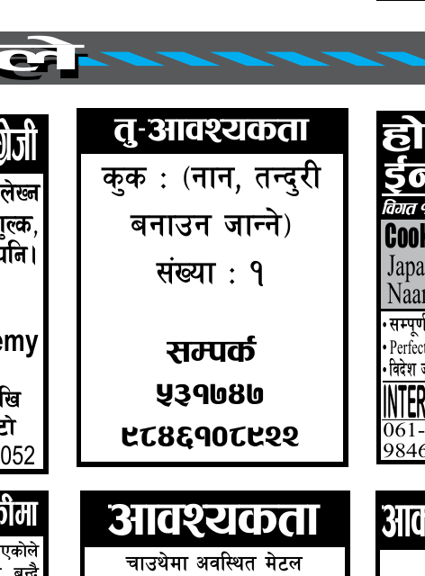 — [full page](pages/1084/p5.jpg)

- title: कुक (नान, तन्दुरी) / Cook (Naan, Tandoori)
- organization: 
- location: 
- deadline:  → None
- contact: ५३९७८७, ८८४६९०८८२२
- text_en: Immediately Wanted
Cook: (who knows how to make Naan, Tandoori)
Number: 1
Contact
539787, 8846908822

### job 99 — 2069-09-17 p4 [private]  ☑ right ☐ wrong
  <!-- vision: fields=CORRECT crop=WRONG_AD missing=Friday Restaurant ad -->

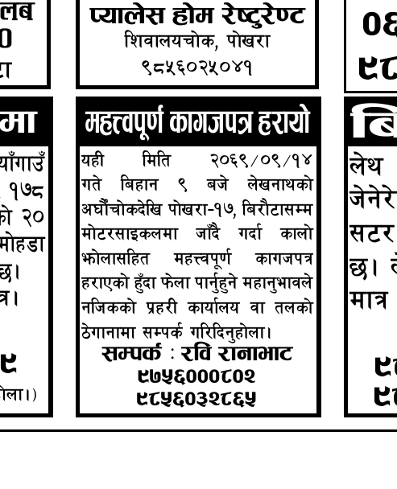 — [full page](pages/1/p4.jpg)

- title: वेटर (Waiter)
- organization: प्यालेस होम रेष्ट्रुेण्ट
- location: शिवालयचोक, पोखरा
- deadline:  → None
- contact: ९८५६०२५०४१
- text_en: Urgently Wanted
Waiter: 3 males
Kitchen helper: 1 male
Experienced candidates preferred.
Opportunity also for morning-shift campus students.
Contact
Palace Home Restaurant
Shivalaya Chowk, Pokhara
9856025041

### job 195 — 2072-12-23 p5 [private]  ☑ right ☐ wrong
  <!-- vision: fields=CORRECT crop=MATCHES missing=none -->

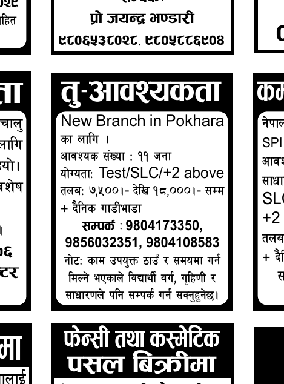 — [full page](pages/1084/p5.jpg)

- title: कर्मचारी (नयाँ शाखा) / Staff (New Branch)
- organization: 
- location: पोखरा
- deadline:  → None
- contact: 9804173350, 9856032351, 9804108583
- text_en: Immediately Wanted
For a New Branch in Pokhara.
Required number: 11 persons
Qualification: Test/SLC/+2 above
Salary: Rs. 7,500/- to 18,000/- + daily vehicle fare
Contact: 9804173350, 9856032351, 9804108583
Note: Since the work location and timing are flexible, students, homemakers and general applicants may also contact.

### job 108 — 2069-09-17 p4 [foreign]  ☑ right ☐ wrong
  <!-- vision: fields=CORRECT crop=MATCHES missing=Working Visa for Poland ad -->

 — [full page](pages/1/p4.jpg)

- title: CareGiver
- organization: Zentrum
- location: Sweden, Denmark & Netherlands
- deadline:  → None
- contact: 01-4387623, 061-431826, 9806648095
- text_en: CareGiver Jobs in Sweden, Denmark & Netherlands
Hurry Up
Limited Seats Only!
Zentrum
01-4387623, 061-431826
9806648095

### job 11 — 2072-12-23 p1 [private]  ☑ right ☐ wrong
  <!-- vision: fields=CORRECT crop=MATCHES missing=OR TWO K Restaurant vacancies -->

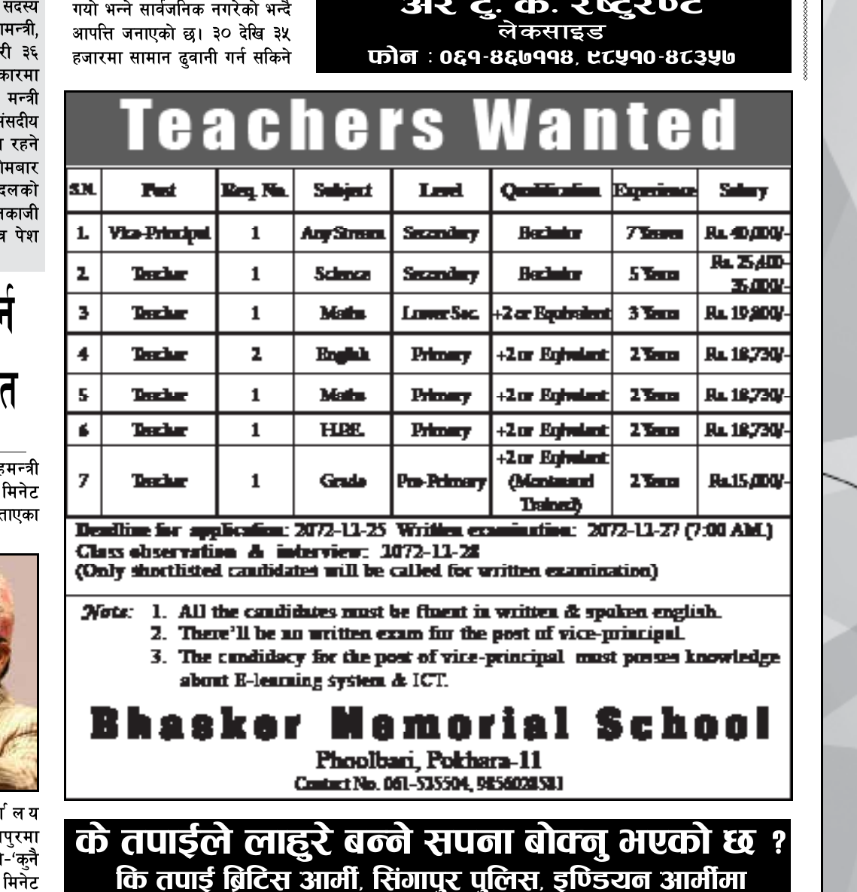 — [full page](pages/1084/p1.jpg)

- title: Teacher (English, Primary)
- organization: Bhasker Memorial School
- location: Phoolbari, Pokhara-11
- deadline: 2072-11-25 → 2016-03-08
- contact: 061-535504, 9456028581
- text_en: Teachers Wanted
SN | Post | Req. No | Subject | Level | Qualification | Experience | Salary
1. Vice-Principal, 1, Any Stream, Secondary, Bachelor, 7 Years, Rs. 40,000/-
2. Teacher, 1, Science, Secondary, Bachelor, 5 Years, Rs. 25,400-35,000/-
3. Teacher, 1, Maths, Lower Sec., +2 or Equivalent, 3 Years, Rs. 19,200/-
4. Teacher, 2, English, Primary, +2 or Equivalent, 2 Years, Rs. 18,730/-
5. Teacher, 1, Maths, Primary, +2 or Equivalent, 2 Years, Rs. 18,730/-
6. Teacher, 1, H.P.E., Primary, +2 or Equivalent, 2 Years, Rs. 18,730/-
7. Teacher, 1, Grade, Pre-Primary, +2 or Equivalent (Montessori Trained), 2 Years, Rs. 15,000/-
Deadline for application: 2072-11-25   Written examination: 2072-11-27 (7:00 AM)
Class observation & interview: 2072-11-28
(Only shortlisted candidates will be called for written examination)
Note: 1. All the candidates must be fluent in written & spoken english.
2. There'll be no written exam for the post of vice-principal.
3. The candidacy for the post of vice-principal must posses knowledge about E-learning system & ICT.
Bhasker Memorial School
Phoolbari, Pokhara-11
Contact No. 061-535504, 9456028581

### job 67 — 2083-06-10 p3 [private]  ☑ right ☐ wrong
  <!-- vision: fields=CORRECT crop=MATCHES missing=the -->

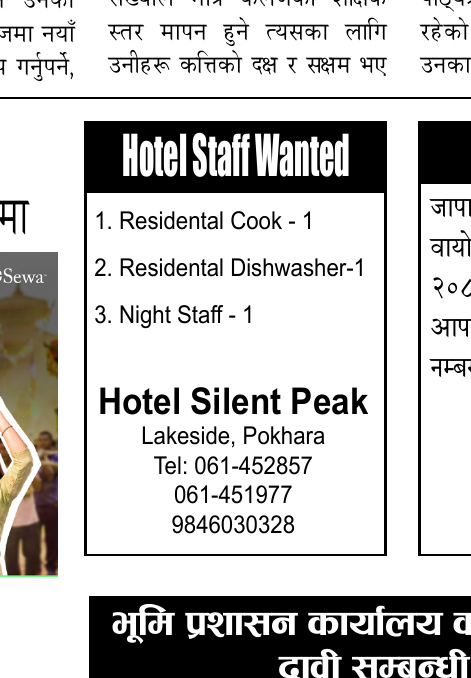 — [full page](pages/4644/p3.jpg)

- title: Residential Dishwasher
- organization: Hotel Silent Peak
- location: Lakeside, Pokhara
- deadline:  → None
- contact: 061-452857, 061-451977, 9846030328
- text_en: Hotel Staff Wanted
1. Residential Cook - 1
2. Residential Dishwasher - 1
3. Night Staff - 1
Hotel Silent Peak
Lakeside, Pokhara
Tel: 061-452857
061-451977
9846030328

### job 131 — 2070-03-23 p4 [training]  ☑ right ☐ wrong
  <!-- vision: fields=CORRECT crop=MATCHES missing=none -->

 — [full page](pages/180/p4.jpg)

- title: कोरियन भाषा / EPS-TOPIC तयारी कक्षा (Korean Language / EPS-TOPIC prep class)
- organization: पोखरा भाषा तालिम केन्द्र (Pokhara Bhasha Talim Kendra)
- location: पन्थीगल्ली, सर्वेश्वरमार्ग, पोखरा
- deadline:  → None
- contact: ९८४६७१८०००, ९८४६०२८०३०, ०६१-६६६७५०
- text_en: Korean Language (classes open)
New batches are actively running from the new course provided by HRD Korea for the upcoming 4th EPS-TOPIC.
1) New coursebook translator and publisher
2) Entire course via projector
3) Hostel arrangement available
4) Special discount for those coming in a group
5) Extra classes also available
Pokhara Bhasha Talim Kendra (Pokhara Language Training Centre)
Panthi Galli, Sarbeshwor Marg, Pokhara
9846718000, 9846028030
061-666750, Pro. Hitkaji Gurung

### job 125 — 2070-03-23 p4 [foreign]  ☑ right ☐ wrong
  <!-- vision: fields=CORRECT crop=MATCHES missing=Pragati English Boarding School -->

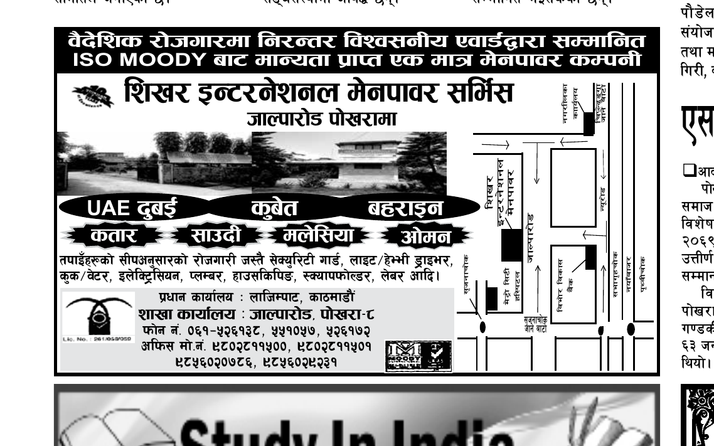 — [full page](pages/180/p4.jpg)

- title: इलेक्ट्रिसियन / Electrician
- organization: शिखर इन्टरनेशनल मेनपावर सर्भिस (Shikhar International Manpower Service)
- location: UAE, कुवेत, बहराइन, कतार, साउदी, मलेसिया, ओमन
- deadline:  → None
- contact: फोन: ०६१-५२६१३८, ५५१०५७, ५२६१७२; मो: ९८०२८११५००, ९८०२८११५०१, ९८५६०२०७८६, ९८५६०२८२३१
- text_en: Continuously honored with a trusted award in foreign employment
The only Nepali company accredited by ISO MOODY
Shikhar International Manpower Service
Jalpa Road, Pokhara
UAE Dubai, Kuwait, Bahrain, Qatar, Saudi Arabia, Malaysia, Oman
Jobs according to your skills such as Security Guard, Light/Heavy Driver, Cook/Waiter, Electrician, Plumber, Housekeeping, Scaffolder, Labour, etc.
Head Office: Lazimpat, Kathmandu
Branch Office: Jalpa Road, Pokhara-8
Phone No. 061-526138, 551057, 526172
Office Mobile No. 9802811500, 9802811501, 9856020786, 9856028231

### job 104 — 2069-09-17 p4 [private]  ☑ right ☐ wrong
  <!-- vision: fields=CORRECT crop=MATCHES missing=none -->

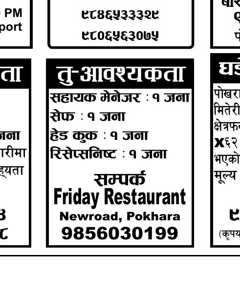 — [full page](pages/1/p4.jpg)

- title: रिसेप्सनिष्ट (Receptionist)
- organization: Friday Restaurant
- location: Newroad, Pokhara
- deadline:  → None
- contact: 9856030199
- text_en: Urgently Wanted
Assistant Manager: 1 person
Chef: 1 person
Head Cook: 1 person
Receptionist: 1 person
Contact
Friday Restaurant
Newroad, Pokhara
9856030199

### job 201 — 2072-12-23 p5 [private]  ☑ right ☐ wrong
  <!-- vision: fields=CORRECT crop=MATCHES missing=none -->

 — [full page](pages/1084/p5.jpg)

- title: Electronics Mobile Repair
- organization: सिद्धार्थ कम्प्युटर एण्ड इलेक्ट्रोनिक्स (Siddhartha Computer and Electronics)
- location: सिद्धार्थचोक-8, पोखरा
- deadline:  → None
- contact: 9856030718, 061-531384
- text_en: Wanted
Computer Technician - 2
Req.: Computer, Laptop assemble, dissemble, OS installation.
Electronics mobile repair: 1
Req.: With Bike Licence
Contact
Siddhartha Computer and Electronics
Siddharthachok-8, Pokhara
9856030718, 061-531384

### job 78 — 2083-06-13 p3 [private]  ☑ right ☐ wrong
  <!-- vision: fields=CORRECT crop=MATCHES missing=Hotel Staff Wanted -->

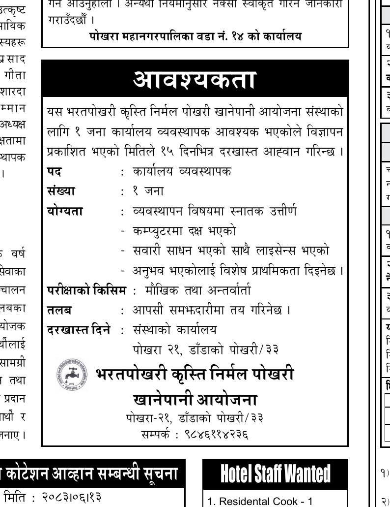 — [full page](pages/4647/p3.jpg)

- title: कार्यालय व्यवस्थापक (Office Manager)
- organization: भरतपोखरी कृष्ति निर्मल पोखरी खानेपानी आयोजना
- location: पोखरा-२१, डाँडाको पोखरी/३३
- deadline: प्रकाशित भएको मितिले १५ दिनभित्र → 2026-10-14 (derived)
- contact: ९८४६११४३२६
- text_en: NEEDED

Bharatpokhari Kristi Nirmal Pokhari Drinking Water Project organization needs 1 Office Manager; applications are invited within 15 days from the date this advertisement is published.

Position: Office Manager
Number: 1 person
Qualification: Bachelor's degree in Management
- Proficient in computers
- Has own vehicle and license
- Prior experience will be given special priority.
Exam type: Oral and interview
Salary: To be decided by mutual agreement
Where to apply: Organization's office
Pokhara 21, Dandako Pokhari/33

Bharatpokhari Kristi Nirmal Pokhari Drinking Water Project
Pokhara-21, Dandako Pokhari/33
Contact: 9846114326

### job 123 — 2070-03-23 p4 [foreign]  ☑ right ☐ wrong
  <!-- vision: fields=CORRECT crop=MATCHES missing=Pragati English Boarding School -->

 — [full page](pages/180/p4.jpg)

- title: लाइट/हेभी ड्राइभर / Light-Heavy Driver
- organization: शिखर इन्टरनेशनल मेनपावर सर्भिस (Shikhar International Manpower Service)
- location: UAE, कुवेत, बहराइन, कतार, साउदी, मलेसिया, ओमन
- deadline:  → None
- contact: फोन: ०६१-५२६१३८, ५५१०५७, ५२६१७२; मो: ९८०२८११५००, ९८०२८११५०१, ९८५६०२०७८६, ९८५६०२८२३१
- text_en: Continuously honored with a trusted award in foreign employment
The only Nepali company accredited by ISO MOODY
Shikhar International Manpower Service
Jalpa Road, Pokhara
UAE Dubai, Kuwait, Bahrain, Qatar, Saudi Arabia, Malaysia, Oman
Jobs according to your skills such as Security Guard, Light/Heavy Driver, Cook/Waiter, Electrician, Plumber, Housekeeping, Scaffolder, Labour, etc.
Head Office: Lazimpat, Kathmandu
Branch Office: Jalpa Road, Pokhara-8
Phone No. 061-526138, 551057, 526172
Office Mobile No. 9802811500, 9802811501, 9856020786, 9856028231

### job 92 — 2069-09-17 p2 [foreign]  ☑ right ☐ wrong
  <!-- vision: fields=CORRECT crop=MATCHES missing=Dubai Security Guard -->

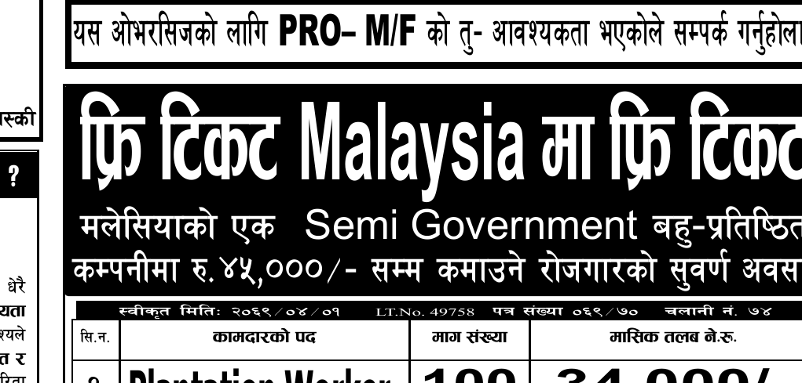 — [full page](pages/1/p2.jpg)

- title: Plantation Worker
- organization: The River Overseas Pvt. Ltd.
- location: Malaysia
- deadline:  → None
- contact: The River Overseas Pvt. Ltd., Prithvi Chowk, Pokhara, 061-528731, 528732, 528733, 9856025127, 9802827786
- text_en: Free ticket, free ticket to Malaysia. Golden employment opportunity to earn up to NPR 45,000/- at a prestigious Semi-Government company in Malaysia. Approval date: 2069/04/01, LT.No. 49758, Letter No. 069/70, Reference No. 74. S.N. 1, Position: Plantation Worker, No. required: 100, Monthly salary NPR: 34,000/-. Final interviews are ongoing. The River Overseas Pvt. Ltd., Branch office: Prithvi Chowk, Pokhara. Phone: 061-528731, 528732, 528733, 9856025127, 9802827786.

### job 150 — 2072-12-23 p3 [private]  ☑ right ☐ wrong
  <!-- vision: fields=CORRECT crop=MATCHES missing=Om Academy -->

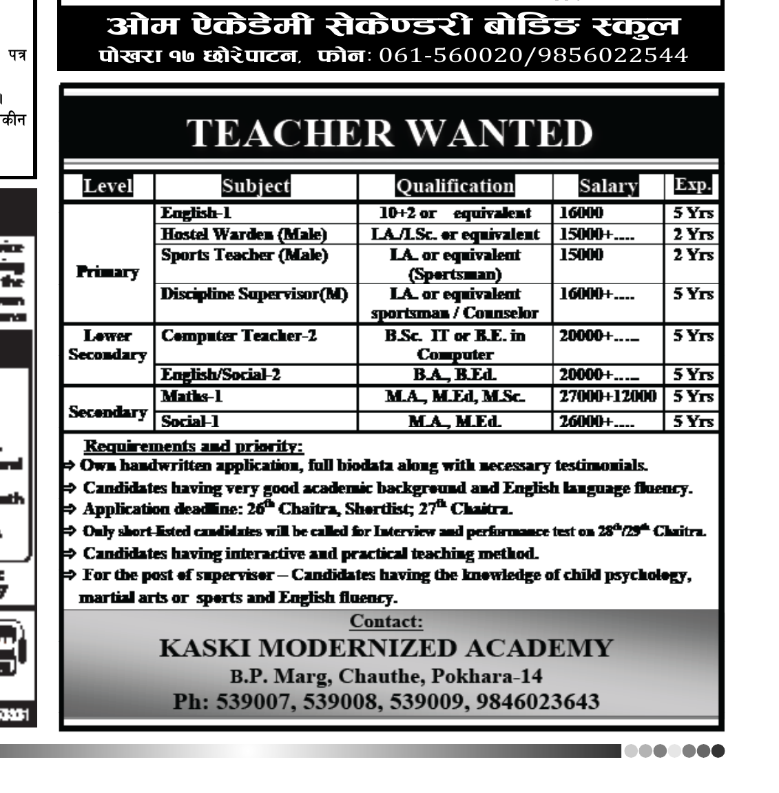 — [full page](pages/1084/p3.jpg)

- title: English Teacher-1
- organization: Kaski Modernized Academy
- location: B.P. Marg, Chauthe, Pokhara-14
- deadline: 26th Chaitra → 2016-04-08
- contact: 539007, 539008, 539009, 9846023643
- text_en: TEACHER WANTED

Level Subject Qualification Salary Exp.
Primary: English-1, 10+2 or equivalent, 16000, 5 Yrs
Primary: Hostel Warden (Male), I.A./I.Sc. or equivalent, 15000+, 2 Yrs
Primary: Sports Teacher (Male), I.A. or equivalent (Sportsman), 15000, 2 Yrs
Primary: Discipline Supervisor (M), I.A. or equivalent sportsman/Counselor, 16000+, 5 Yrs
Lower Secondary: Computer Teacher-2, B.Sc. IT or B.E. in Computer, 20000+, 5 Yrs
Lower Secondary: English/Social-2, B.A., B.Ed., 20000+, 5 Yrs
Secondary: Maths-1, M.A., M.Ed, M.Sc., 27000+12000, 5 Yrs
Secondary: Social-1, M.A., M.Ed., 26000+, 5 Yrs

Requirements and priority:
- Own handwritten application, full biodata along with necessary testimonials.
- Candidates having very good academic background and English language fluency.
- Application deadline: 26th Chaitra, Shortlist: 27th Chaitra.
- Only short-listed candidates will be called for interview and performance test on 28th/29th Chaitra.
- Candidates having interactive and practical teaching method.
- For the post of supervisor - candidates having knowledge of child psychology, martial arts or sports, and English fluency.

Contact:
KASKI MODERNIZED ACADEMY
B.P. Marg, Chauthe, Pokhara-14
Ph: 539007, 539008, 539009, 9846023643

### job 56 — 2079-09-05 p3 [private]  ☑ right ☐ wrong
  <!-- vision: fields=CORRECT crop=MATCHES missing=Metropolitan Academy -->

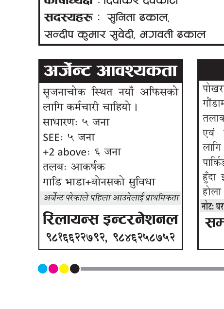 — [full page](pages/3353/p3.jpg)

- title: कर्मचारी (General staff)
- organization: रिलायन्स इन्टरनेशनल (Reliance International)
- location: Srijana Chowk, Pokhara
- deadline:  → None
- contact: 9816622712, 9846258752
- text_en: Urgently Required
Staff needed for a new office located at Srijana Chowk.
General: 5 persons
SEE: 5 persons
+2 above: 6 persons
Salary: attractive
Vehicle fare + bonus facility
Since it is urgent, priority to those who come first
Reliance International
9816622712, 9846258752

### job 130 — 2070-03-23 p4 [private]  ☑ right ☐ wrong
  <!-- vision: fields=CORRECT crop=MATCHES missing=many other ads on the page -->

 — [full page](pages/180/p4.jpg)

- title: मार्केटिङ अफिसर / Marketing Officer
- organization: Vitro Natural Pokhara
- location: Ranipauwa, Pokhara
- deadline:  → None
- contact: 9802822099, 9846258244
- text_en: Vacancy
As Vitro Naturals company's Western Regional Dealer needs some additional Marketing Officers, interested individuals should get in contact immediately with their biodata.
Also, a wholesale seller is needed for Pokhara, so registered firms may also apply.
Salary + bonus (can earn more than Rs. 10,000/- per month).
Contact
Vitro Natural Pokhara
Ranipauwa, Pokhara
9802822099, 9846258244

### job 36 — 2072-12-23 p2 [private]  ☑ right ☐ wrong
  <!-- vision: fields=CORRECT crop=MATCHES missing=Sagarmatha Niketan School -->

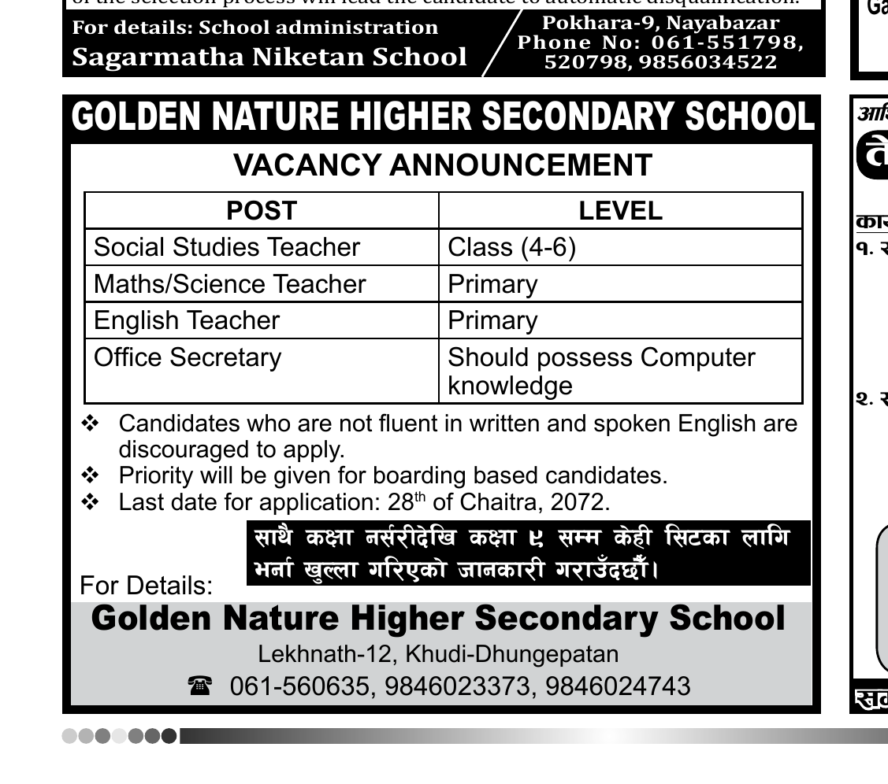 — [full page](pages/1084/p2.jpg)

- title: Social Studies Teacher
- organization: Golden Nature Higher Secondary School
- location: Lekhnath-12, Khudi-Dhungepatan
- deadline: 28th of Chaitra, 2072 → 2016-04-10
- contact: 061-560635, 9846023373, 9846024743
- text_en: GOLDEN NATURE HIGHER SECONDARY SCHOOL
VACANCY ANNOUNCEMENT
POST | LEVEL
Social Studies Teacher | Class (4-6)
Maths/Science Teacher | Primary
English Teacher | Primary
Office Secretary | Should possess Computer knowledge
Candidates who are not fluent in written and spoken English are discouraged from applying.
Priority will be given to boarding-based candidates.
Last date for application: 28th of Chaitra, 2072.
Also, admission is open for a few seats from Nursery to class 5.
For Details:
Golden Nature Higher Secondary School
Lekhnath-12, Khudi-Dhungepatan
061-560635, 9846023373, 9846024743

### job 73 — 2083-06-11 p3 [private]  ☑ right ☐ wrong
  <!-- vision: fields=CORRECT crop=MATCHES missing=none | vision said UNSURE; 'Night Staff - 1' is role 3 of a 3-role ad and the fields and contact match exactly -->

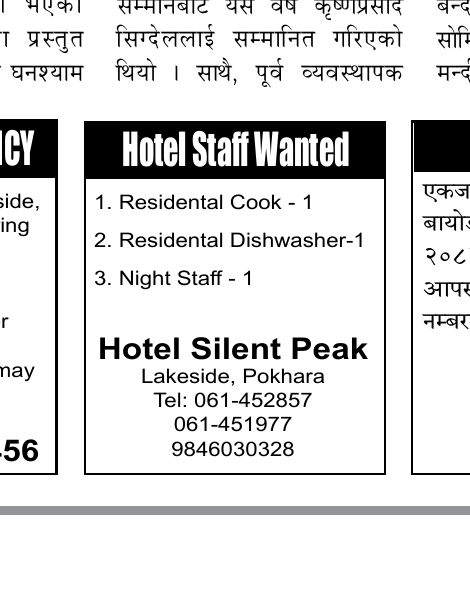 — [full page](pages/4645/p3.jpg)

- title: Night Staff
- organization: Hotel Silent Peak
- location: Lakeside, Pokhara
- deadline:  → None
- contact: 061-452857, 061-451977, 9846030328
- text_en: Hotel Staff Wanted
1. Residential Cook - 1
2. Residential Dishwasher - 1
3. Night Staff - 1
Hotel Silent Peak
Lakeside, Pokhara
Tel: 061-452857
061-451977
9846030328

### job 202 — 2072-12-23 p5 [training]  ☑ right ☐ wrong
  <!-- vision: fields=CORRECT crop=MATCHES missing=many other ads on the page -->

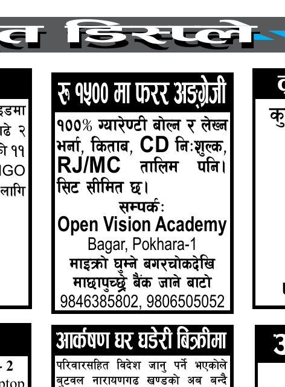 — [full page](pages/1084/p5.jpg)

- title: फर्राटा अंग्रेजी तथा RJ/MC तालिम / Spoken English and RJ/MC Training
- organization: Open Vision Academy
- location: Bagar, Pokhara-1
- deadline:  → None
- contact: 9846385802, 9806505052
- text_en: Fluent English for Rs. 1500
100% guarantee to speak and write; enrollment, books, CD free, RJ/MC training also available. Seats limited.
Contact: Open Vision Academy
Bagar, Pokhara-1
On the road from Bagar Chowk (micro turning point) to Machhapuchhre Bank
9846385802, 9806505052

### job 194 — 2072-12-23 p5 [training]  ☑ right ☐ wrong
  <!-- vision: fields=CORRECT crop=MATCHES missing=none -->

 — [full page](pages/1084/p5.jpg)

- title: होटल तालिम (कुक/वेटर) / Hotel Training (Cook/Waiter)
- organization: INTERNATIONAL Hotel Training Center
- location: न्यूरोड, पोखरा
- deadline:  → None
- contact: 061-541394, 9846020322
- text_en: Hotel Training International
Enrolling continuously for the past 12 years.
Cook - 3 months, Waiter - 2 months
1 month for those going to Japan
Naan, Tandoori Cook Perfect
Entire course taught by five-star hotel trainers
If not perfect, re-training and job placement arranged
Assistance provided with documents for those going abroad
INTERNATIONAL Hotel Training Center
New Road, Pokhara, in front of Goshi, opposite VOYE Restaurant
061-541394, 9846020322

### job 25 — 2072-12-23 p2 [private]  ☑ right ☐ wrong
  <!-- vision: fields=CORRECT crop=MATCHES missing=Sagarmatha Niketan School -->

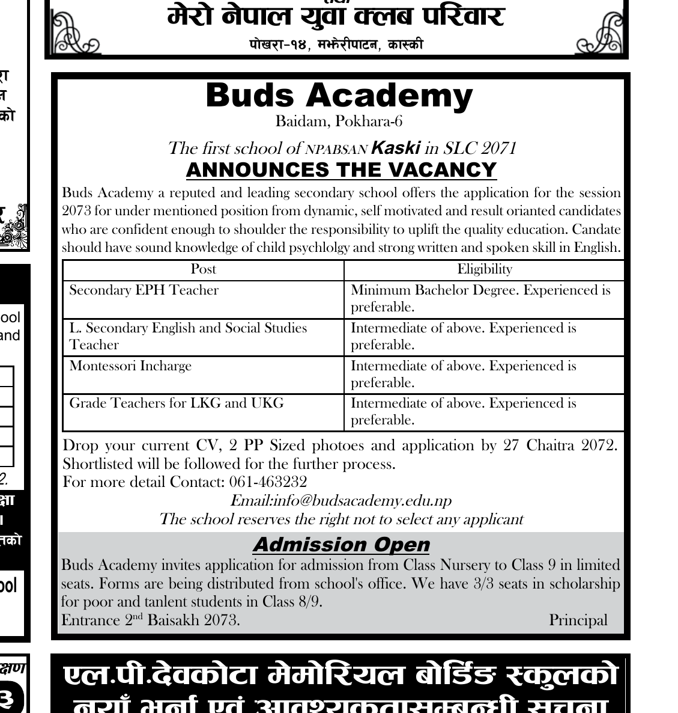 — [full page](pages/1084/p2.jpg)

- title: Grade Teachers for LKG and UKG
- organization: Buds Academy
- location: Baidam, Pokhara-6
- deadline: 27 Chaitra 2072 → 2016-04-09
- contact: Phone: 061-463232; Email: info@budsacademy.edu.np
- text_en: Buds Academy
Baidam, Pokhara-6
The first school of NPABSAN Kaski in SLC 2071
ANNOUNCES THE VACANCY
Buds Academy, a reputed and leading secondary school, invites applications for session 2073 for the positions mentioned below from dynamic, self-motivated and result-oriented candidates confident enough to shoulder the responsibility of uplifting quality education. Candidates should have sound knowledge of child psychology and strong written and spoken English skills.
Post | Eligibility
Secondary EPH Teacher | Minimum Bachelor Degree. Experience preferable.
L. Secondary English and Social Studies Teacher | Intermediate or above. Experience preferable.
Montessori Incharge | Intermediate or above. Experience preferable.
Grade Teachers for LKG and UKG | Intermediate or above. Experience preferable.
Drop your current CV, 2 passport-size photos and application by 27 Chaitra 2072. Shortlisted candidates will be contacted for further process.
For more detail contact: 061-463232
Email: info@budsacademy.edu.np
The school reserves the right not to select any applicant.
Admission Open
Buds Academy invites applications for admission from Class Nursery to Class 9 for limited seats. Forms are being distributed from the school office. We have 3/3 scholarship seats for poor and talented students in Class 8/9.
Entrance exam 2nd Baisakh 2073.
Principal

### job 159 — 2072-12-23 p3 [private]  ☑ right ☐ wrong
  <!-- vision: fields=CORRECT crop=MATCHES missing=Teachers Wanted | vision said WRONG, but title/org/positions/contact all match the ad; it read other ads on the page as errors in this record -->

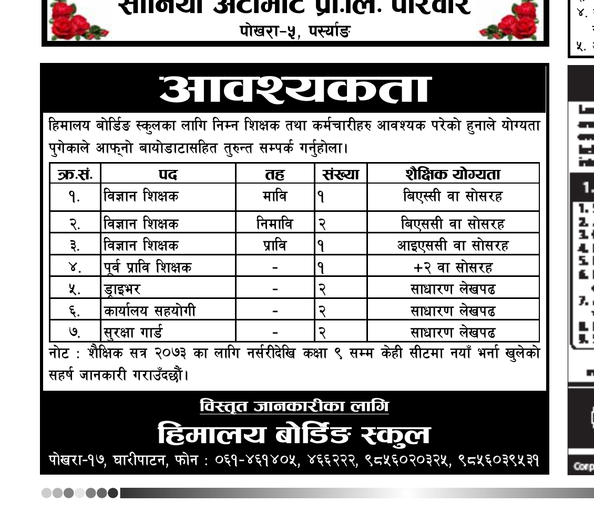 — [full page](pages/1084/p3.jpg)

- title: Science Teacher
- organization: Himalaya Boarding School
- location: Pokhara-17, Gharipatan
- deadline:  → None
- contact: 061-461405, 466222, 9856020325, 9856039531
- text_en: Vacancy

Himalaya Boarding School requires the following teachers and staff. Qualified candidates should contact immediately with their bio-data.

SN Post Level Number Educational Qualification
1. Science Teacher Secondary 1 B.Sc. or equivalent
2. Science Teacher Lower Secondary 2 B.Sc. or equivalent
3. Science Teacher Primary 1 I.Sc. or equivalent
4. Pre-Primary Teacher - 1 +2 or equivalent
5. Driver - 2 Basic literacy
6. Office Assistant - 2 Basic literacy
7. Security Guard - 2 Basic literacy

Note: For academic session 2073, a few new admission seats are open from Nursery up to grade 9.

For detailed information:
Himalaya Boarding School
Pokhara-17, Gharipatan, Phone: 061-461405, 466222, 9856020325, 9856039531

### job 65 — 2083-06-10 p3 [private]  ☑ right ☐ wrong
  <!-- vision: fields=CORRECT crop=MATCHES missing=Hotel Silent Peak -->

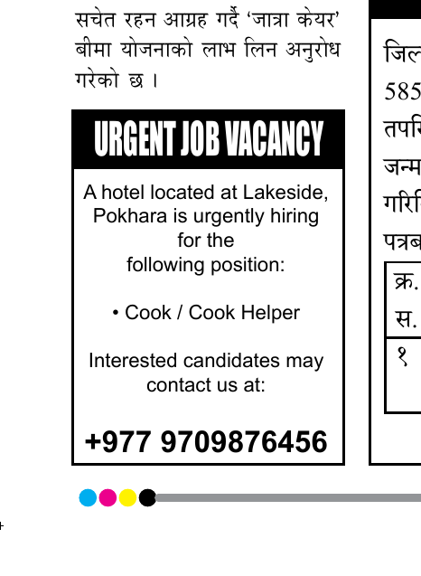 — [full page](pages/4644/p3.jpg)

- title: Cook / Cook Helper
- organization: 
- location: Lakeside, Pokhara
- deadline:  → None
- contact: +977 9709876456
- text_en: URGENT JOB VACANCY
A hotel located at Lakeside, Pokhara is urgently hiring for the following position:
• Cook / Cook Helper
Interested candidates may contact us at:
+977 9709876456

### job 137 — 2070-03-23 p4 [private]  ☑ right ☐ wrong
  <!-- vision: fields=CORRECT crop=MATCHES missing=Pragati English Boarding School vacancy announcement -->

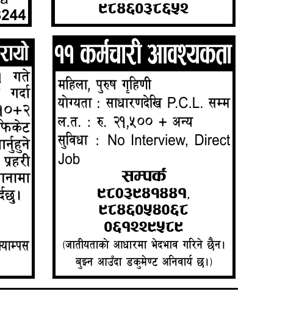 — [full page](pages/180/p4.jpg)

- title: कर्मचारी / Staff
- organization: 
- location: 
- deadline:  → None
- contact: ८८०३८४९४४७, ८८४६०५४८०६, ०६१२२५४५८
- text_en: 11 Staff Wanted
Women, men, housewives
Qualification: General to P.C.L.
Salary: Rs. 21,500 + other benefits
Facility: No Interview, Direct Job
Contact
8803849447, 8846054806, 0612254588 (as printed)
(No discrimination will be made on the basis of caste/ethnicity. Bringing documents is mandatory when coming.)

### job 181 — 2076-04-22 p5 [private]  ☑ right ☐ wrong
  <!-- vision: fields=CORRECT crop=MATCHES missing=none -->

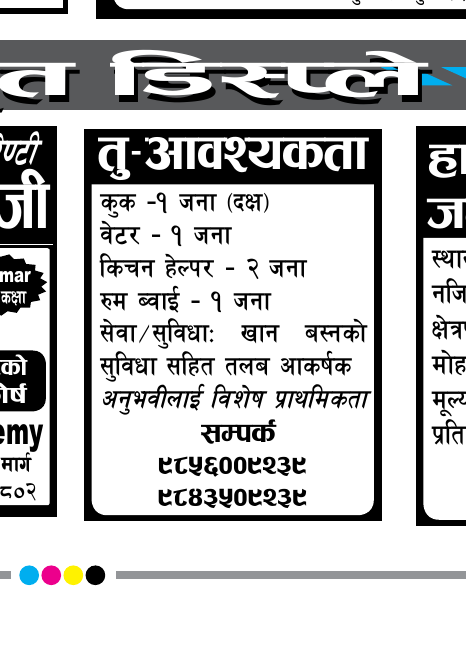 — [full page](pages/2216/p5.jpg)

- title: किचन हेल्पर
- organization: 
- location: 
- deadline:  → None
- contact: ९८५६००१२३८, ९८४३५००१२३८
- text_en: Staff Needed
Cook - 1 person (Skilled)
Waiter - 1 person
Kitchen Helper - 2 persons
Room Boy - 1 person
Service/Facility: Attractive salary with food and lodging
Experienced candidates given special priority
Contact: 9856001238, 9843501238

### job 155 — 2072-12-23 p3 [private]  ☑ right ☐ wrong
  <!-- vision: fields=CORRECT crop=MATCHES missing=Om Academy Secondary Boarding School teacher posts and Himalaya Boarding School teacher vacancies -->

 — [full page](pages/1084/p3.jpg)

- title: English/Social Teacher
- organization: Kaski Modernized Academy
- location: B.P. Marg, Chauthe, Pokhara-14
- deadline: 26th Chaitra → 2016-04-08
- contact: 539007, 539008, 539009, 9846023643
- text_en: TEACHER WANTED

Level Subject Qualification Salary Exp.
Primary: English-1, 10+2 or equivalent, 16000, 5 Yrs
Primary: Hostel Warden (Male), I.A./I.Sc. or equivalent, 15000+, 2 Yrs
Primary: Sports Teacher (Male), I.A. or equivalent (Sportsman), 15000, 2 Yrs
Primary: Discipline Supervisor (M), I.A. or equivalent sportsman/Counselor, 16000+, 5 Yrs
Lower Secondary: Computer Teacher-2, B.Sc. IT or B.E. in Computer, 20000+, 5 Yrs
Lower Secondary: English/Social-2, B.A., B.Ed., 20000+, 5 Yrs
Secondary: Maths-1, M.A., M.Ed, M.Sc., 27000+12000, 5 Yrs
Secondary: Social-1, M.A., M.Ed., 26000+, 5 Yrs

Requirements and priority:
- Own handwritten application, full biodata along with necessary testimonials.
- Candidates having very good academic background and English language fluency.
- Application deadline: 26th Chaitra, Shortlist: 27th Chaitra.
- Only short-listed candidates will be called for interview and performance test on 28th/29th Chaitra.
- Candidates having interactive and practical teaching method.
- For the post of supervisor - candidates having knowledge of child psychology, martial arts or sports, and English fluency.

Contact:
KASKI MODERNIZED ACADEMY
B.P. Marg, Chauthe, Pokhara-14
Ph: 539007, 539008, 539009, 9846023643

### job 38 — 2072-12-23 p2 [private]  ☑ right ☐ wrong
  <!-- vision: fields=CORRECT crop=MATCHES missing=Sagarmatha Niketan School vacancies -->

 — [full page](pages/1084/p2.jpg)

- title: English Teacher
- organization: Golden Nature Higher Secondary School
- location: Lekhnath-12, Khudi-Dhungepatan
- deadline: 28th of Chaitra, 2072 → 2016-04-10
- contact: 061-560635, 9846023373, 9846024743
- text_en: GOLDEN NATURE HIGHER SECONDARY SCHOOL
VACANCY ANNOUNCEMENT
POST | LEVEL
Social Studies Teacher | Class (4-6)
Maths/Science Teacher | Primary
English Teacher | Primary
Office Secretary | Should possess Computer knowledge
Candidates who are not fluent in written and spoken English are discouraged from applying.
Priority will be given to boarding-based candidates.
Last date for application: 28th of Chaitra, 2072.
Also, admission is open for a few seats from Nursery to class 5.
For Details:
Golden Nature Higher Secondary School
Lekhnath-12, Khudi-Dhungepatan
061-560635, 9846023373, 9846024743

### job 80 — 2083-06-13 p3 [private]  ☑ right ☐ wrong
  <!-- vision: fields=CORRECT crop=MATCHES missing=the other two positions in the same ad -->

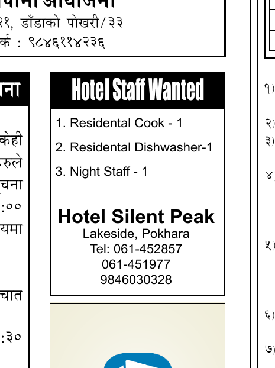 — [full page](pages/4647/p3.jpg)

- title: Residential Dishwasher
- organization: Hotel Silent Peak
- location: Lakeside, Pokhara
- deadline:  → None
- contact: 061-452857, 061-451977, 9846030328
- text_en: Hotel Staff Wanted

1. Residential Cook - 1
2. Residential Dishwasher - 1
3. Night Staff - 1

Hotel Silent Peak
Lakeside, Pokhara
Tel: 061-452857, 061-451977, 9846030328

### job 26 — 2072-12-23 p2 [private]  ☑ right ☐ wrong
  <!-- vision: fields=CORRECT crop=MATCHES missing=Golden Nature Higher Secondary School vacancies -->

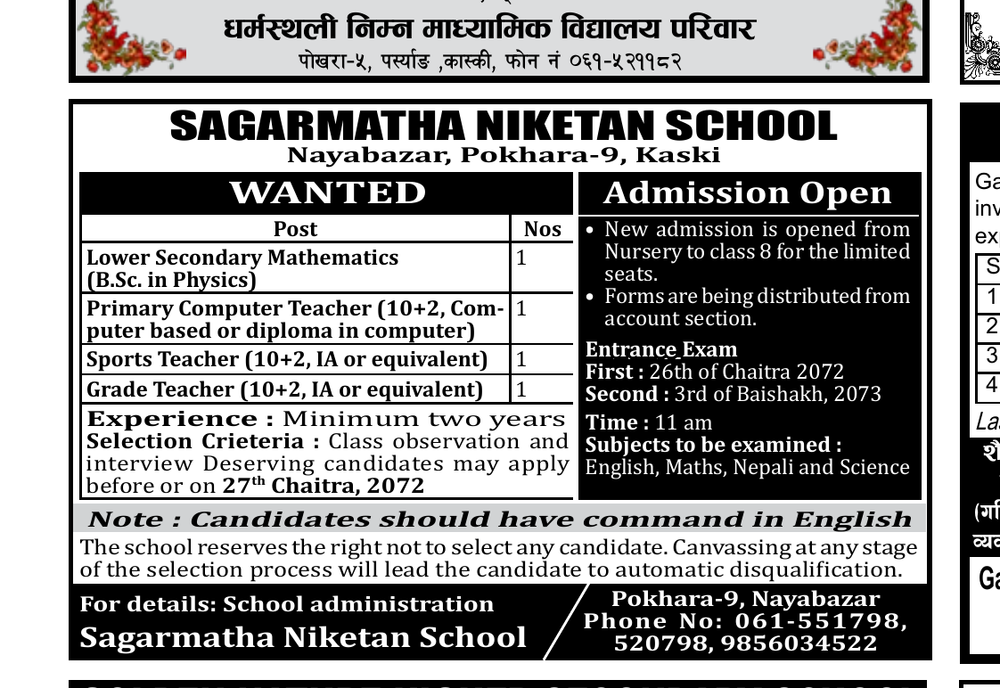 — [full page](pages/1084/p2.jpg)

- title: Lower Secondary Mathematics Teacher
- organization: Sagarmatha Niketan School
- location: Nayabazar, Pokhara-9, Kaski
- deadline: 27th Chaitra, 2072 → 2016-04-09
- contact: Phone No: 061-551798, 520798, 9856034522
- text_en: SAGARMATHA NIKETAN SCHOOL
Nayabazar, Pokhara-9, Kaski
WANTED
Post | Nos
Lower Secondary Mathematics (B.Sc. in Physics) | 1
Primary Computer Teacher (10+2, computer based or diploma in computer) | 1
Sports Teacher (10+2, IA or equivalent) | 1
Grade Teacher (10+2, IA or equivalent) | 1
Experience: minimum two years
Selection criteria: class observation and interview. Deserving candidates may apply on or before 27th Chaitra, 2072.
Admission Open
New admissions open from Nursery to class 8 for limited seats. Forms are being distributed from the accounts section.
Entrance Exam
First: 26th of Chaitra 2072
Second: 3rd of Baishakh, 2073
Time: 11 am
Subjects examined: English, Maths, Nepali and Science
Note: Candidates should be able to command English.
The school reserves the right not to select any candidate. Canvassing at any stage of the selection process will lead to automatic disqualification.
For details: School administration
Sagarmatha Niketan School
Pokhara-9, Nayabazar
Phone No: 061-551798, 520798, 9856034522

### job 187 — 2076-04-22 p5 [private]  ☑ right ☐ wrong
  <!-- vision: fields=CORRECT crop=MATCHES missing=none -->

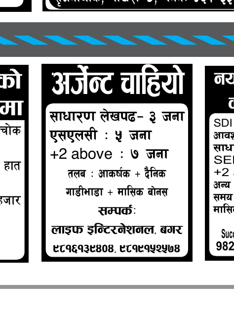 — [full page](pages/2216/p5.jpg)

- title: SLC उत्तीर्ण कर्मचारी
- organization: लाइफ इन्टरनेशनल
- location: बगर, पोखरा
- deadline:  → None
- contact: ९८७६९३४८०८, ९८७९१५२५७४
- text_en: Urgently Needed
Basic literacy - 3 persons
SLC: 5 persons
+2 above: 7 persons
Salary: Attractive + daily transport allowance + monthly bonus
Contact:
Life International, Bagar
9876934808, 9879152574